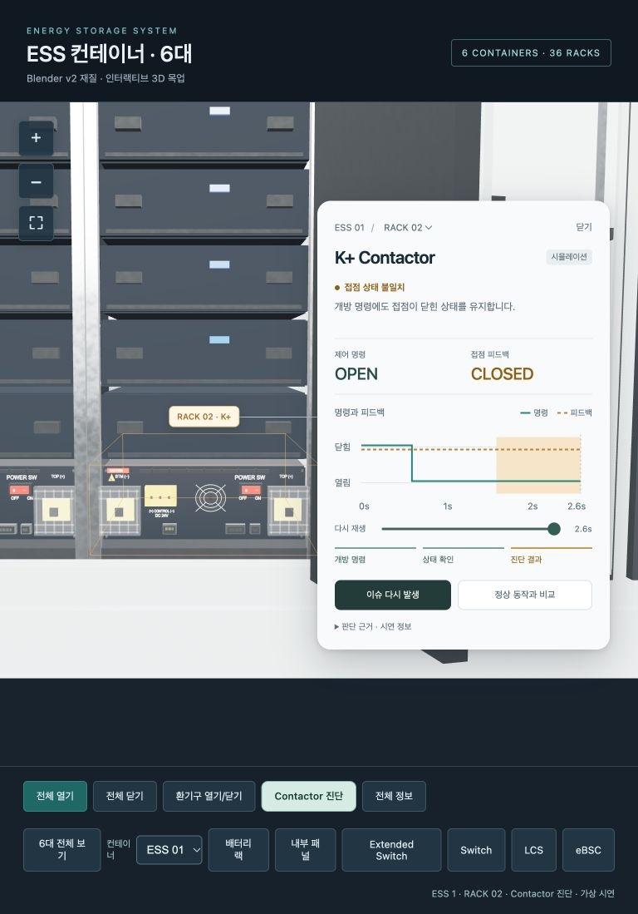
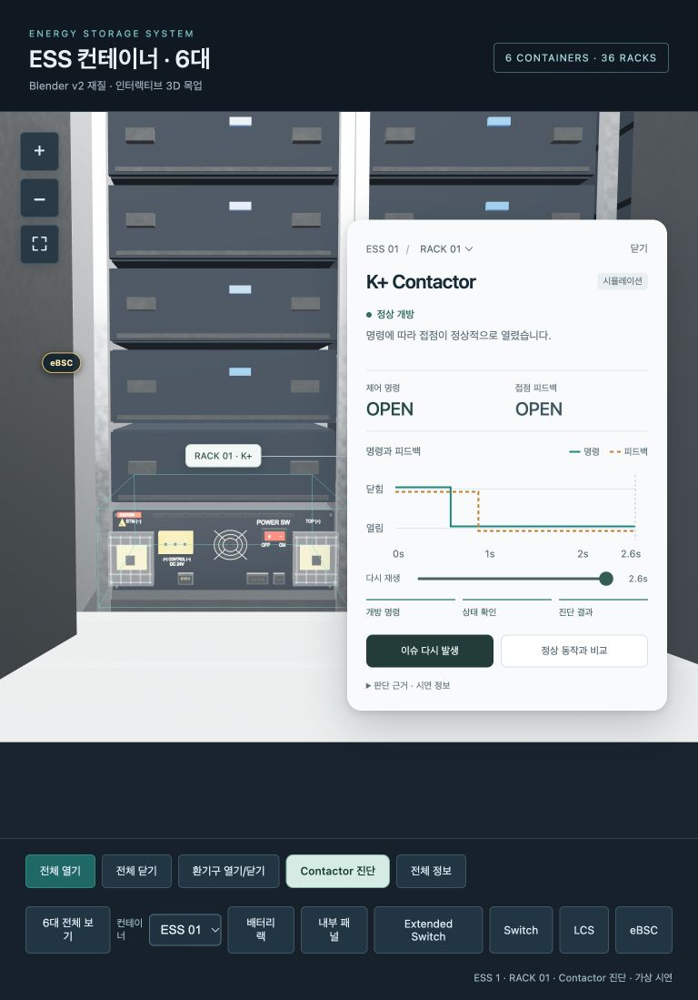

# ESS Contactor 진단 말풍선

작성일: 2026-10-22

기존 ESS 3D 뷰어에서 `Contactor 진단`을 누르면 선택한 랙의 BPU 위치로 이동하고, 그 위치에 연결된 말풍선에서 고장 발생 과정을 재생합니다. 현재 구현은 실제 장비와 연결하지 않은 진단 화면 시연입니다.

## 1. 화면과 의도

고정된 큰 패널과 접촉기 내부 그림을 보여주던 방식을 부품 옆의 말풍선으로 바꿨습니다. 사용자가 장비 위치와 진단 근거를 함께 보면서 이슈를 발생시키고 정상 동작과 비교할 수 있도록 구성했습니다.



- 3D 강조와 연결선: 선택한 ESS와 랙의 BPU 외함 위치를 가리킵니다.
- 말풍선: 제어 명령, 접점 피드백, 현재 진단과 시간에 따른 신호 추이를 표시합니다.
- 이슈 재생: 정상 대기에서 개방 명령을 보내고, 피드백이 바뀌지 않는 과정을 보여줍니다.
- 판단 근거: 긴 설명과 데이터의 한계는 `판단 근거 · 시연 정보`에서 펼쳐봅니다.

## 2. 조작 방법

1. 하단 `Contactor 진단`을 누릅니다. 기본 대상은 현재 선택된 ESS의 RACK 02이며 불일치 시연이 자동 시작됩니다.
2. `이슈 다시 발생`을 누르면 같은 대상에서 불일치 과정을 다시 재생합니다.
3. `정상 동작과 비교`를 누르면 개방 명령에 OPEN 피드백이 돌아오는 정상 예시로 바뀝니다.
4. `일시정지`와 `재생`으로 진행을 제어하고 시간 막대로 이전·이후 상태를 확인합니다. 시간 막대는 키보드 방향키와 Home/End로도 조작할 수 있습니다.
5. 말풍선의 랙 선택 또는 하단 컨테이너 선택을 바꾸면 새 대상에서 현재 시나리오를 처음부터 재생합니다. 진단 모드에서 기존 랙 라벨을 클릭해도 대상이 바뀝니다.
6. `판단 근거 · 시연 정보`를 펼치면 설명과 `통신 끊김 시연`을 볼 수 있습니다.
7. `닫기`, Esc 또는 `Contactor 진단`을 다시 누르면 말풍선과 강조가 닫힙니다. `전체 정보`, `6대 전체 보기`, 다른 장비 보기로 전환할 때도 해당 보기와 겹치지 않게 닫힙니다.



## 3. 시연 상태와 시간

아래 시간과 조건은 제품 사양이 아닌 화면 시연용 가상값입니다.

| 재생 시점 | 불일치 예시 | 정상 예시 | 통신 끊김 예시 |
|---|---|---|---|
| 0.0~0.6초 미만 | CLOSED 명령 / CLOSED 피드백, 정상 대기 | 동일 | 동일 |
| 0.6초 | OPEN 명령, 응답 확인 | OPEN 명령, 응답 확인 | 피드백 UNKNOWN, 판정 불가 |
| 0.9초 | CLOSED 피드백 유지 | OPEN 피드백 수신, 정상 개방 | UNKNOWN 유지 |
| 1.6초 초과 | 개방 명령 후 1.0초를 초과해 불일치 판정 | 정상 개방 유지 | 판정 불가 유지 |
| 2.6초 | 자동 재생 종료 | 자동 재생 종료 | 자동 재생 종료 |

그래프는 명령을 실선, 피드백을 점선으로 구분합니다. 불일치 판정 구간은 배경으로 표시하고 통신 미수신 이후에는 피드백 선을 이어 그리지 않습니다. 색상뿐 아니라 상태 문구와 OPEN/CLOSED/UNKNOWN 값을 함께 표시합니다.

모션 감소 설정에서는 자동 진입 시 결과를 즉시 표시하고 카메라 전환 및 고장 강조 점멸을 줄입니다. 실제 재생을 원하는 경우 재생 버튼으로 시작할 수 있습니다.

## 4. 확인할 수 있는 범위

- 현재 화면은 가상 명령과 피드백의 불일치를 설명합니다. 이 결과만으로 접점 용착을 확정하지 않습니다.
- 3D 모델에서 확인한 위치는 BPU 외함입니다. 내부 접촉기의 실제 위치·형상은 확인하지 않았으며 내부를 관측한 화면이 아닙니다.
- 실장비 연결, 실제 접촉기 제어, Modbus 수집 및 보호 동작은 구현하지 않았습니다.
- 기존 4+2 컨테이너 배치, 문 개폐·접촉 제한, 일반 진단 패널과 데이터는 함께 유지합니다. 문 동작은 3D 목업의 동작입니다.

## 5. 구현 위치

| 파일 | 역할 |
|---|---|
| `src/contactor.ts` | 가상 명령·피드백·진단 상태와 준비 구간 계산 |
| `src/contactorDiagnostics.ts` | 말풍선, 자동 재생·비교·시간 이동, 신호 그래프 |
| `src/main.ts` | BPU 강조, 카메라 이동, 3D 앵커 위치와 말풍선 연결 |
| `src/diagnostics.ts` | 일반 진단과 Contactor 모드의 상호 전환 |
| `src/style.css` | 말풍선의 여백·색·글자·반응형 배치 |
| `tests/contactor.test.ts` | 준비 구간, 정상 전환, 불일치 시간 경계와 UNKNOWN 검증 |

진단 UI는 내부 `contactorfocus` 이벤트로 `{ rackId, diagnosis, focus }`를 전달합니다. `contactorclose`에서 강조와 카메라 전환을 정리합니다. 이 이벤트들은 현재 앱 내부 연결이며 외부 시스템용 공개 API는 아닙니다.

## 6. 실행과 검증

저장소에서 다음 명령으로 빌드하고 로컬 서버를 실행합니다.

```sh
npm ci
npm run build
PORT=3006 npm start
```

브라우저에서 `http://127.0.0.1:3006/`를 열고, 서버를 실행한 상태에서 별도 터미널로 검증합니다.

```sh
ESS_TEST_URL=http://127.0.0.1:3006 npm test
git diff --check
```

포터블 ZIP에는 실행 빌드, 모델, 소스, 테스트와 이 문서를 포함합니다. ZIP을 풀고 `node server.ts`를 실행하면 기본 주소는 `http://127.0.0.1:3000/`입니다. Node.js 22.18 이상이 필요하며 실행만 할 때는 npm 설치가 필요 없습니다.

확인한 항목:

- TypeScript 검사와 Vite 빌드.
- 진단 상태 및 시간 경계 테스트, 기존 랙·문·컨테이너 배치 테스트.
- 실제 브라우저에서 자동 이슈 재생, 정상 비교, 통신 끊김, 정지/재생, 시간 이동과 대상 변경.
- 일반 정보·전체 보기 복귀, 닫기와 키보드 조작.
- 320px·390px 폭에서 문서와 말풍선의 가로 넘침 없음.
- 화면 전후·부분 비교와 글자 대비 조정. 상세 기록은 [디자인 검토](../design-qa.md)에 있습니다.
- 포터블 ZIP 66개 항목의 무결성과 현재 파일과의 일치. 별도 임시 폴더에 압축을 풀고 npm 설치 없이 서버를 실행해 3D 모델, 불일치 재생과 정상 비교를 브라우저에서 확인했습니다.

실제 설비 진단 성능, 전체 접근성 적합성, Windows 실행 및 모든 브라우저 환경까지 검증했다는 의미는 아닙니다.
