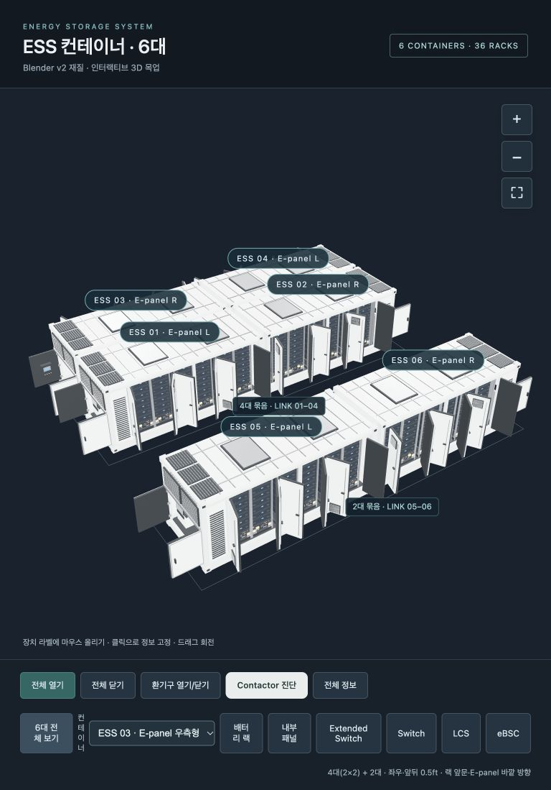
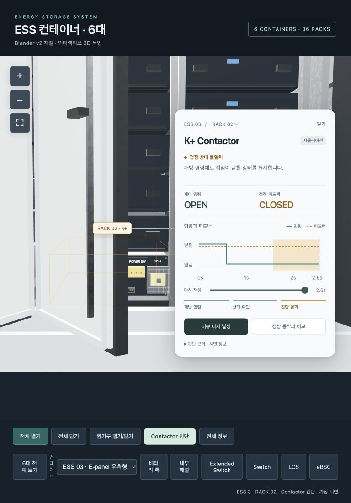

# LINK 화면을 재현하는 C# 및 프런트엔드 구현 가이드

작성 기준: 2026-10-23의 `ess-web-six` 웹 구현.

이 가이드는 아래 화면의 **LINK 좌우형, 4+2 배치, 문 개폐와 부품에 연결된 진단 말풍선**을 다른 프런트엔드 또는 C# 앱에서 재현하기 위한 구현 기준이다. 같은 3D 모델과 배치 규칙으로 두 환경의 배치를 일치시킨다. C#의 네이티브 3D 예시는 이 저장소의 Unity 사용을 기준으로 한다.



## 1 구현 경로 선택

| 대상 | 재사용 경로 | 추가로 구현할 것 |
|---|---|---|
| C# 서버와 웹 프런트엔드 | 기존 웹 뷰어의 `dist/` 전체를 HTTP로 제공하고 화면에 포함 | 서버 데이터 공급자와 선택 이벤트 어댑터 |
| C# 데스크톱 앱의 WebView | HTTP로 제공한 동일 웹 뷰어를 WebView에서 열기 | 호스트와 웹 사이의 메시지 계약 |
| React 또는 Vue에 직접 통합 | Three.js 모델·배치 코드를 재사용하고 UI를 컴포넌트로 이식 | 초기화·해제, 이벤트 범위, 스타일 범위 |
| Unity C#로 직접 렌더링 | 현재 GLB를 가져와 좌우형 프리팹과 같은 배치 규칙 사용 | 좌표 정규화, 문 제약, 카메라, UI 앵커 |

기존 웹 화면을 그대로 사용할 때는 `dist/index.html`, `dist/assets/`, `dist/models/`를 함께 제공한다. `file://`로 HTML만 여는 방식은 사용하지 않는다. iframe을 사용하는 예시는 다음과 같다.

```html
<iframe src="/ess-viewer/" title="ESS 3D 뷰어"
        style="width:100%;height:800px;border:0"></iframe>
```

현재 앱에는 부모 창 메시지 API나 완성된 React mount/unmount API가 없다. C# 또는 부모 프런트엔드에서 장비 선택과 데이터를 전달하려면 어댑터를 추가한다. 세부 계약은 [시스템 이식 안내](../INTEGRATION.md)를 따른다.

## 2 같은 화면을 만드는 공통 규칙

- **L/R의 기준은 해당 LINK의 랙 앞문을 바라보는 사람이다.** L은 E-panel 좌측형, R은 우측형이다. 화면 카메라를 돌려도 타입은 바뀌지 않는다.
- 01·02와 03·04가 2×2 네 대 묶음이다. 두 줄은 등을 맞대며 랙 앞문이 각각 바깥을 향한다.
- 네 대 묶음의 **좌우·앞뒤 외곽 사이 빈 간격 모두 0.5ft = 0.1524m = 152.4mm**다. 중심점 사이 거리가 아니다.
- E-panel은 각 묶음의 X축 양쪽 바깥에 있다. 별도 05·06번 쌍까지의 4m 통로는 화면용 임시값이다.
- 각 LINK는 랙 6개, 팩 42개, BPU 6개를 갖는다. 각 랙의 BPU와 데이터 ID 연결을 유지한다.

다음 표의 좌표와 회전은 웹 모델의 공통 좌표계다. 단위는 m, 위쪽은 +Y, 회전 전 랙 앞문은 +Z를 향한다. 기본 L 모델의 E-panel은 −X에 있다.

| 컨테이너 ID | 타입 | 행 | Y 회전 | 랙 앞문 방향 | E-panel의 현장 X 방향 |
|---|---|---|---|---|---|
| 01 | L | 0 | 0° | +Z 바깥 | −X |
| 02 | R | 0 | 0° | +Z 바깥 | +X |
| 03 | R | 1 | 180° | −Z 바깥 | −X |
| 04 | L | 1 | 180° | −Z 바깥 | +X |
| 05 | L | 2 | 0° | +Z | −X |
| 06 | R | 2 | 0° | +Z | +X |

03번은 R 타입이어도 현장 좌표에서는 E-panel이 −X에 있다. 타입과 현장 회전은 서로 다른 값으로 저장한다.

## 3 모델과 장치 식별

현재 화면의 형상 기준 파일은 [`public/models/ess-container.glb`](../public/models/ess-container.glb)다. 이 GLB는 L 타입 원본이며, 웹은 복제할 때 R 타입을 생성한다. 치수는 시각화 모델의 치수이며 실측 CAD 치수로 사용하지 않는다.

| 노드 이름 | 용도 |
|---|---|
| `Internal_Battery_Racks` | 랙 6개의 부모 |
| `BPU_01` … `BPU_06` | 각 랙 하단의 진단 강조 대상 |
| `Door_Hinge_01` … `Door_Hinge_06` | 랙 문 회전축 |
| `Front_Left_Hinge`, `Front_Right_Hinge` | 장비실 문 회전축 |
| `E_Panel_Detailed` | E-panel 내부 조립체 |
| `LCS_Controller`, `eBSC_Controller` | 제어기 확대·정보 대상 |
| `Extended_Switch`, `Network_Switch_IE3500` | 네트워크 장치 |
| `FACP_Inside_Door` | 장비실 문을 따라 움직이는 부품 |

장비의 키는 `(containerId, rackId)` 또는 `(containerId, equipmentId)`다. 외부 컨테이너 ID는 1~6이고 현재 웹 배열 인덱스는 0~5다. R 타입에서 랙의 화면상 좌우 순서가 바뀌어도 X 좌표로 정렬해 ID를 다시 붙이지 않는다. `BPU_02`는 계속 해당 LINK의 RACK 02에 연결한다.

기존 `UnityProject/Assets/ESS_Blender_v2/Editor/ESSBlenderImporter.cs`는 `Blender/UnityTransfer/model.json`을 읽는 별도 가져오기 경로다. 기존 Unity 프리팹을 열었다고 최신 웹 GLB의 좌우형·문 제약·진단이 자동 반영되지는 않는다.

## 4 좌우형 생성과 인쇄 방향

현재 웹의 R 타입 생성은 [`ESSModel.clone(panelSide)`](../src/ESSModel.ts)에 있다.

1. 원본 계층을 복제하고 root의 X scale을 반전한다. 랙 앞문 방향인 Z는 그대로 둔다.
2. 인쇄가 있는 재질과 그 texture map을 복제한다. 공유한 L 타입 재질을 직접 변경하지 않는다.
3. 복제한 인쇄 map의 `repeat.x *= -1`, `offset.x = 1 - offset.x`로 글씨 방향을 보정한다.
4. 회전축, 노드 ID, FACP의 부모 관계를 보존한다.

Unity에서 같은 목업을 만들 경우 L 프리팹을 복제해 R 프리팹을 만들고, 정규화된 root에 X 반전을 적용한다. 해당 프리팹의 인쇄 재질만 별도로 만들어 U 방향을 보정한다. URP/Lit의 `_BaseMap`을 쓰는 재질이라면 Texture Scale X와 Offset X에 같은 계산을 적용할 수 있다. 다른 셰이더는 해당 셰이더의 UV 속성에 대응시킨다. 실제 R 전용 자산을 사용할 때는 이미 보정된 글씨를 다시 반전하지 않는다.

음수 scale을 사용할 때는 대상 렌더러에서 표면 방향과 셰이딩도 확인한다. 오른쪽 타입의 내부 배선·기기 배치는 현재 좌우 대응 목업이다. 실물 R 타입 내부를 검증한 형상은 아니다.

## 5 간격을 유지하는 배치 계산

**모든 문과 환기 덮개를 닫은 상태**에서 배치한다. 열린 문의 외곽으로 다시 계산하면 컨테이너 위치가 달라진다. 경계 계산 대상은 모델 형상이며 UI 라벨, 바닥, 강조 박스는 제외한다.

각 root를 원점에 놓고 타입과 행 회전을 적용한 뒤 외곽 `minX`, `maxX`, `minZ`, `maxZ`를 구한다. `D`는 회전 전 닫힌 모델의 Z 깊이이며, `g = 0.1524`다.

| 위치 | root 이동량 |
|---|---|
| 왼쪽 열 X | `-g / 2 - maxX` |
| 오른쪽 열 X | `g / 2 - minX` |
| 행 0 Z | `g / 2 - minZ` |
| 행 1 Z | `-g / 2 - maxZ` |
| 별도 행 2 Z | `g / 2 + D + 4 - minZ` |

모델의 원점은 외곽 중심과 일치하지 않는다. 따라서 `폭 / 2`만으로 놓거나 이미지에서 보이는 간격을 눈대중으로 맞추지 않는다.

현재 GLB의 닫힌 외곽은 약 `6.5475 × 2.8490 × 2.7210m`(X/Y/Z)다. 이 자산에서 계산한 root 위치는 아래와 같다. 소수점 6자리로 반올림한 비교값이며, 자산을 바꾸면 위 계산식으로 다시 구한다.

| ID | 웹 root X | 웹 root Z | 아래 Unity 변환의 root Z |
|---|---|---|---|
| 01 | −3.311200 | +1.370200 | −1.370200 |
| 02 | +3.311200 | +1.370200 | −1.370200 |
| 03 | −3.311200 | −1.370200 | +1.370200 |
| 04 | +3.311200 | −1.370200 | +1.370200 |
| 05 | −3.311200 | +8.091200 | −8.091200 |
| 06 | +3.311200 | +8.091200 | −8.091200 |

root Y 이동량은 0이다. 이 표는 root 위치이며 모델 외곽 중심 좌표가 아니다.

## 6 프런트엔드 재사용 예시

다음은 저장소 안에서 기존 클래스를 사용하는 초기화 예시다. 장면·렌더러·UI 초기화는 [`src/main.ts`](../src/main.ts)를 기준으로 연결한다.

```ts
import * as THREE from 'three';
import { ESSModel } from './ESSModel';
import { arrangeContainers, LINK_PANEL_SIDES } from './ContainerLayout';

const source = await ESSModel.load('./models/ess-container.glb');
const models = LINK_PANEL_SIDES.map(side => source.clone(side));
const scene = new THREE.Scene();
models.forEach((model, index) => {
  model.root.name = `ESS_${index + 1}`;
  scene.add(model.root);
});
const siteBounds = arrangeContainers(models.map(model => model.root));
```

`ESSModel`은 문 상태를 모델별로 보관한다. 매 프레임 각 모델의 `update(deltaSeconds)`를 호출해야 문이 움직인다. `setAll(true/false)`는 열기/닫기 요청이며, `toggleObject(hit.object)`는 클릭한 문과 그 짝을 처리한다.

복제 모델은 형상과 일부 재질을 공유한다. 위 예시의 source 또는 복제본 하나를 임의로 `dispose()`하면 다른 인스턴스가 쓰는 자원을 해제할 수 있다. 앱에 이식할 때 모델별 제거와 공유 자원의 최종 해제를 분리한다. 기존 전체 앱은 전역 DOM ID와 `document` 이벤트를 사용하므로 한 페이지에 여러 뷰어를 붙일 때도 범위 분리가 필요하다.

## 7 Unity C# 좌표와 배치 예시

### 좌표 정규화

Unity는 왼손 좌표계를 사용한다. 이 가이드의 이식 규칙은 **웹 `(x, y, z)`를 Unity `(x, y, -z)`로 대응**시키는 것이다. 이는 이 가이드에서 선택한 변환 규칙이며 모든 GLB importer의 기본 동작을 뜻하지 않는다. [Unity 좌표계 설명](https://docs.unity.com/en-us/engine/6000.0/manual/working-with-gameobjects/gameobject-fundamentals/rotation-orientation/quaternion-and-euler-rotations-in-unity)을 참고한다.

가져온 L 자산을 먼저 다음 상태로 정규화한다.

- 1 unit = 1m, 위쪽 +Y, 랙 앞문 방향은 Unity **−Z**.
- E-panel은 root 기준 −X, root의 회전 0°, L root scale은 `(1,1,1)`.
- importer의 축 보정은 root 아래의 자산 계층에서 끝낸다. 이미 축이 맞으면 추가 반전을 하지 않는다.
- R 프리팹은 같은 정규화 기준에서 좌우 반전하고 인쇄 보정을 완료한다. 문과 환기 덮개는 닫혀 있어야 한다.

이후 root의 0°/180° 배치는 표와 같다. 일반 회전, 힌지 축, quaternion을 웹에서 Unity로 넘길 때는 importer 변환에 맞춰 별도 변환한다. 문 각도에 무조건 같은 부호 또는 반대 부호를 적용하지 않는다.

### 엔진에 의존하지 않는 배치 계산

`LinkLayoutMath.cs`에 둘 수 있는 계산 예시다. 입력 min/max는 **해당 타입과 행 회전을 적용하고 root 위치를 0으로 둔 상태의 웹 공통 좌표 외곽**이다.

```csharp
public static class LinkLayoutMath
{
    public const float Gap = 0.1524f;
    public static readonly bool[] PanelOnRight =
        { false, true, true, false, false, true };

    public static float YawDegrees(int index) =>
        index / 2 == 1 ? 180f : 0f;

    public static (float X, float Z) Position(
        int index, float minX, float maxX,
        float minZ, float maxZ, float closedDepth)
    {
        int row = index / 2;
        float x = index % 2 == 0
            ? -Gap / 2f - maxX : Gap / 2f - minX;
        float z = row == 1
            ? -Gap / 2f - maxZ
            : Gap / 2f + (row == 2 ? closedDepth + 4f : 0f) - minZ;
        return (x, z);
    }
}
```

### Unity에서 외곽을 전달하는 예시

아래 코드는 `LinkSite.cs`로 둘 수 있는 Unity 어댑터 예시다. Inspector에 앞 절에서 정규화한 L/R 프리팹을 지정한다. 프리팹은 모델 Renderer를 한 개 이상 포함하며, 바닥·UI·강조 선은 포함하지 않는다. 생성된 여섯 root는 최상위에 놓고, 배치 시 Animator나 문 제어기가 닫힌 형상을 바꾸지 않게 한다.

```csharp
using UnityEngine;

public sealed class LinkSite : MonoBehaviour
{
    [SerializeField] Transform leftPrefab;
    [SerializeField] Transform rightPrefab;

    static Vector3 FlipZ(Vector3 p) => new Vector3(p.x, p.y, -p.z);

    static Bounds CanonicalBounds(Transform root)
    {
        var renderers = root.GetComponentsInChildren<Renderer>(true);
        Bounds bounds = renderers[0].bounds;
        for (int i = 1; i < renderers.Length; i++)
            bounds.Encapsulate(renderers[i].bounds);
        // Z reflection preserves AABB size; its center changes sign.
        return new Bounds(FlipZ(bounds.center), bounds.size);
    }

    void Start()
    {
        var roots = new Transform[6];
        for (int i = 0; i < roots.Length; i++)
        {
            var prefab = LinkLayoutMath.PanelOnRight[i]
                ? rightPrefab : leftPrefab;
            roots[i] = Instantiate(prefab);
            roots[i].name = $"ESS_{i + 1}";
            roots[i].position = Vector3.zero;
            roots[i].rotation = Quaternion.identity;
        }

        float depth = CanonicalBounds(roots[0]).size.z;
        for (int i = 0; i < roots.Length; i++)
        {
            var root = roots[i];
            root.rotation = Quaternion.Euler(0, LinkLayoutMath.YawDegrees(i), 0);
            Bounds b = CanonicalBounds(root);
            var p = LinkLayoutMath.Position(
                i, b.min.x, b.max.x, b.min.z, b.max.z, depth);
            root.position = FlipZ(new Vector3(p.X, 0, p.Z));
        }
    }
}
```

Unity의 [`Renderer.bounds`](https://docs.unity.com/en-us/engine/6000.0/script-reference/unityengine/renderer/bounds)는 월드 좌표의 축 정렬 경계다. 위 예시는 root가 원점인 상태에서 측정하고, Z 부호를 바꾼 공통 좌표 외곽을 계산 함수에 전달한다. root를 이미 이동한 뒤 그 외곽을 다시 입력하면 이동량이 중복된다.

## 8 문과 카메라 재현

랙 양문은 1–2, 3–4, 5–6번 짝이며, 짝의 가운데에서 서로 갈라져 바깥으로 열린다. 웹의 목표 각도는 홀수 랙 문 −105°, 짝수 +105°다. 이웃한 2–3, 4–5번 문은 문짝·손잡이·경첩·덮개의 접촉을 검사하여 제한한다. 두 이웃 문을 함께 요청했을 때 약 81°의 공통 각도로 열리며, 상대 문을 닫아도 남은 문이 자동으로 다시 열리지는 않는다. [`DoorContact.ts`](../src/DoorContact.ts)의 OBB 검사·substep·안전 각도 탐색을 이식하거나 동일 동작의 제약을 구현한다.

현재 웹 GLB는 이웃 네 문의 테두리 16개를 로컬 Z 방향으로 15mm 낮춰, 기존 약 59° 제한을 81°로 넓혔다. 경첩·손잡이·문판과 충돌 코드는 그대로다. Blender 원본의 이번 테두리 보정은 미반영 상태이므로 재내보내기 후 [`scripts/recess-door-rims.py`](../scripts/recess-door-rims.py)를 실행한다. 현재 GLB에는 이미 반영되어 있으며 이 스크립트는 중복 이동을 방지한다.

실제 화면: [수정 전 약 59°](images/rack-doors-before.jpg) / [수정 후 약 81°](images/rack-doors-after.jpg).

장비실 문은 목업 기준 ±90°다. 기존 100°에서는 0.5ft 뒤쪽 이웃의 문·손잡이와 겹쳤다. 실물 힌지 최대각을 뜻하지 않는다. 환기 덮개는 1·2·5·6번 문에 있으며 45° 개방한다. FACP는 해당 장비실 문 회전축의 자식으로 유지한다.

선택한 모델의 **이동·회전·좌우 반전 모두**를 상세 카메라에 적용한다. 웹은 root의 `localToWorld(point)` 또는 `offset.multiply(root.scale).applyQuaternion(root.quaternion)`을 사용한다. 회전만 적용하면 R 타입의 패널 확대 방향이 틀어진다.

Unity에서 반전 root를 사용하는 경우 점에는 [`TransformPoint`](https://docs.unity3d.com/6000.0/Documentation/ScriptReference/Transform.TransformPoint.html), 이동량에는 [`TransformVector`](https://docs.unity3d.com/6000.0/Documentation/ScriptReference/Transform.TransformVector.html)를 사용해 scale까지 반영한다. [`TransformDirection`](https://docs.unity3d.com/6000.0/Documentation/ScriptReference/Transform.TransformDirection.html)은 scale을 반영하지 않으므로 반전된 카메라 오프셋 용도로 단독 사용하지 않는다. 독립적인 R 실물 자산을 사용한다면 타입별 카메라 앵커를 자산 안에 두는 편이 명확하다.

전체 화면의 웹 기준은 Perspective FOV 40°, 배경 `#18232e`, ACES 노출 1.25다. 전체 외곽 중심을 바라보고 `(-0.9, 1.1, 1.35)` 방향에서 전체 크기·화면 비율에 맞춰 거리를 구한다. Unity에서는 카메라 위치의 Z를 공통 변환에 맞춰 반대로 둔다. 엔진 간 조명·tone mapping 차이 때문에 노출 숫자만 복사해 픽셀 일치를 기대하지 않는다.

## 9 부품에 연결되는 진단 말풍선



`Contactor 진단`을 누르면 선택한 LINK의 RACK 02를 기본 대상으로 이슈가 재생된다. 선택한 `BPU_02`의 월드 경계를 강조하고, 경계 상단 중앙보다 0.12m 높은 점을 말풍선 앵커로 사용한다. 내부 접촉기 형상은 확인하지 않았으므로 **BPU 외함 위치를 가리키는 시뮬레이션**으로 표시한다.

웹의 화면 좌표는 매 프레임 월드 앵커를 camera로 project한 뒤 `x = (ndc.x / 2 + 0.5) × viewportWidth`, `y = (0.5 - ndc.y / 2) × viewportHeight`로 계산한다. CSS 픽셀 크기를 사용하고 canvas의 devicePixelRatio를 다시 곱하지 않는다. 말풍선은 앵커 옆에 두고 화면 밖으로 나가지 않게 제한하며, 카메라 이동과 창 크기 변경 시 다시 계산한다.

Unity는 [`Camera.WorldToScreenPoint`](https://docs.unity3d.com/6000.0/Documentation/ScriptReference/Camera.WorldToScreenPoint.html)로 월드 점을 화면 픽셀에 투영할 수 있다. 이 API의 원점은 화면 왼쪽 아래다. 위쪽 원점을 쓰는 DOM/UI와 연결하면 해당 렌더 영역 높이에서 Y를 빼고, 카메라 pixelRect·Canvas scale·RenderTexture 표시 영역을 함께 반영한다. 카메라 뒤의 점은 숨긴다.

말풍선에 필요한 값은 대상 ID, 명령, 피드백, 현재 판정과 시간이다. 현재 시연 흐름은 다음과 같다.

| 재생 시간 | 정상 | 불일치 | 통신 끊김 |
|---|---|---|---|
| 0.6초 미만 | CLOSED/CLOSED 대기 | 동일 | 동일 |
| 0.6초부터 | OPEN 명령, 피드백 대기 | OPEN 명령, CLOSED 유지 | OPEN 명령, UNKNOWN |
| 0.9초부터 | OPEN/OPEN 정상 | CLOSED 유지 | UNKNOWN 유지 |
| 1.6초 초과 | 정상 유지 | 상태 불일치 판정 | 판정 불가 |
| 2.6초 | 재생 종료 | 재생 종료 | 재생 종료 |

이 시간은 화면 시연용 가상값이다. 불일치만으로 용착을 확정하지 않고, 통신이 끊겼을 때는 CLOSED로 대신 표시하지 않는다. 이슈 재생, 정상 비교, 정지·시간 이동, 랙/컨테이너 전환을 같은 상태 계산에 연결한다. 웹 내부 이벤트 `contactorfocus`는 `{ rackId, diagnosis, focus }`를 전달하며 컨테이너는 현재 선택에서 결정한다. 외부 C# 계약에는 containerId도 포함해야 한다. 자세한 동작은 [Contactor 진단 안내](CONTACTOR_DIAGNOSTICS.md)를 따른다.

## 10 구현 순서와 확인 기준

1. 현재 GLB 한 대를 불러와 축·단위·노드 이름을 확인한다. L/R 두 타입의 앞문 방향은 같고 E-panel 위치가 좌우로 대응하는지 확인한다.
2. 문을 닫고 타입 순서 L/R/R/L/L/R와 행 회전 0°/180°/0°를 적용한다. 양 축의 실제 외곽 간격을 계산한다.
3. 문과 환기 덮개를 열고 닫으며 이웃 문 제약과 컨테이너 사이 비관통을 확인한다. 초기부터 목표 각도로 순간 이동시키지 않는다.
4. 02번 R 타입과 03번 회전된 R 타입에서 랙·E-panel·LCS·eBSC 카메라와 인쇄 방향을 확인한다.
5. 같은 `(containerId, rackId)`로 강조, 말풍선, 그래프, 데이터가 연결되는지 확인한다. 이슈·정상·통신 끊김과 빠른 대상 전환을 포함한다.
6. 전체 보기, 상세 보기, 창 크기 변경, 화면 제거와 재진입을 확인한다.

배치 수치 검사의 권장 오차는 웹 double 계산에서 `1e-6m`, C# float 계산에서는 `1e-4m`다. 각 쌍의 `right.minX - left.maxX`, 두 줄의 `row0.minZ - row1.maxZ`가 모두 0.1524m인지 확인한다. 타입과 회전으로 겉보기 위치가 달라져도 장비 ID는 같아야 한다.

현재 웹의 빌드·실제 GLB 배치·문 개폐·진단 검사는 통과했다. 이 문서의 `LinkLayoutMath`를 .NET 8로 컴파일하고 동일 GLB에서 얻은 여섯 외곽 입력을 대입하여, 타입·회전과 웹 위치가 0.1mm 허용 오차 안에서 일치함을 검증했다. Unity 어댑터와 가져오기·재질·UI는 대상 Unity 프로젝트에서 별도 실행 검증이 필요하다.

```sh
npm run build
ESS_TEST_URL=http://127.0.0.1:3006 npm test
```

## 11 구현 파일 찾기

| 구현할 부분 | 기준 파일 |
|---|---|
| 좌우형·문 개폐 | [`src/ESSModel.ts`](../src/ESSModel.ts) |
| 타입 순서·배치 | [`src/ContainerLayout.ts`](../src/ContainerLayout.ts) |
| 장면·카메라·클릭·앵커 투영 | [`src/main.ts`](../src/main.ts) |
| 이웃 문 접촉 제약 | [`src/DoorContact.ts`](../src/DoorContact.ts) |
| Contactor 상태 계산 | [`src/contactor.ts`](../src/contactor.ts) |
| 진단 말풍선과 재생 | [`src/contactorDiagnostics.ts`](../src/contactorDiagnostics.ts) |
| 일반 진단·데이터 공급자 | [`src/diagnostics.ts`](../src/diagnostics.ts), [`src/telemetry.ts`](../src/telemetry.ts) |
| UI 크기·색·반응형 | [`src/style.css`](../src/style.css) |
| 실제 모델 검증 | [`tests/verify.mjs`](../tests/verify.mjs) |
| 도입·데이터 연결 | [시스템 이식 안내](../INTEGRATION.md) |
| 배치 확정 내용 | [좌우형 LINK 설계](superpowers/specs/2026-10-23-left-right-link-design.md) |
